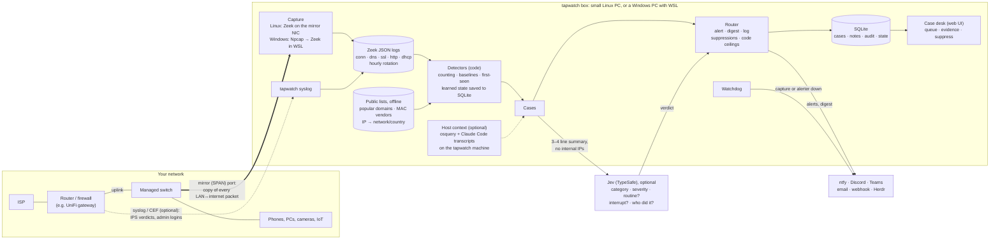

# tapwatch architecture

## The whole system

## Components

| Component | What it does | Where |
|---|---|---|
| **Mirror port** | A managed switch copies the router uplink to the tapwatch box, so it sees every device's internet traffic without being in the path | [docs/setup/mirror-port.md](setup/mirror-port.md) |
| **Capture** | Zeek turns packets into protocol logs (it records; it doesn't decide). It logs MACs in conn.log and rotates hourly. On Windows, Npcap captures and Zeek runs in WSL | `deploy/zeek/`, `deploy/docker-compose.yml`, `eval/capture_mirror.sh` |
| **Router syslog** | The router's own IPS verdicts and admin logins, which the mirror can't see | `tapwatch syslog`, [docs/setup/router-syslog.md](setup/router-syslog.md) |
| **Detectors** | Plain code: time windows, per-device baselines, first-seen sets, household prevalence. What they learn is saved, so restarts don't start over | `src/tapwatch/detectors.py` |
| **Public lists** | Popular domains (Tranco), MAC vendors (IEEE), IP → network and country (iptoasn). Downloaded, never queried live | `tapwatch update-feeds` |
| **Jev** (optional) | Fast typed triage of behaviour cases. It never sees raw logs or internal IPs, never judges whether a domain is "normal" (its measured weak spot), and never overrides always-alert rules | `src/tapwatch/triage.py` |
| **Router** | Decides alert, digest or log. Always-alert cases can't be suppressed or lowered. Detectors can attach code-proven ceilings (`max_route`) that Jev can't exceed | `src/tapwatch/router.py` |
| **Host context** (optional) | For cases on the tapwatch machine: which program made the traffic (osquery), and whether a Claude Code session did it at the owner's request | `src/tapwatch/hostctx.py`, `agents/` |
| **Case desk** | Queue, status and disposition, notes, audit trail, Zeek evidence, "suppress similar", stats. Token login off-box | `tapwatch ui` |
| **Notifications** | ntfy, Discord, Teams, email, generic webhook, and Herdr pop-ups for critical cases | `src/tapwatch/notifiers.py` |
| **Watchdog** | Every 5 minutes: capture running, logs fresh, alerter alive. It notifies once on failure and once on recovery | `eval/watchdog.sh` |
| **Services** | Docker restart policies, or systemd user units (Linux without Docker, and WSL) | `deploy/`, `tapwatch service install` |
| **Eval harness** | Replays captures through rules-only and Jev routing and scores both | `tapwatch eval`, [eval/RESULTS.md](../eval/RESULTS.md) |

## Why it's shaped this way

- **Limited telemetry by design.** No EDR event feed and no SaaS audit logs, only what crosses
  the wire (plus the router's syslog). Code produces facts; Jev supplies fast judgment where
  richer feeds would otherwise give context.
- **Code counts, Jev judges.** Jev's own documentation says it struggles with arithmetic,
  counting, IPs and timestamps, so all of that happens in code. Jev reads a short summary in words.
- **The AI can't silence the important stuff.** Threat-list hits, critical IDS alerts, internet
  exposure, rogue DHCP, exfiltration channels and new router-admin logins always alert, and are
  never sent to Jev.
- **Strings from the network are hostile.** Domains, TLS names and hostnames are quoted and
  labelled as untrusted for Jev, escaped in the UI and email, and defanged in chat and push apps.
- **What leaves the network:** Jev summaries (if enabled), your notifications, and the public
  list downloads. With host context, only yes/no facts reach Jev: no transcript text, session IDs
  or paths. Never internal IPs, MACs or packet contents.
- **Fail safe:** if Jev is down, routing falls back to rules only. If capture or the alerter dies,
  the watchdog tells you.
