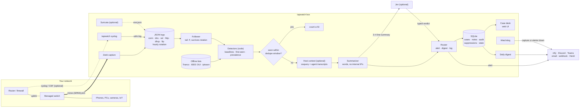
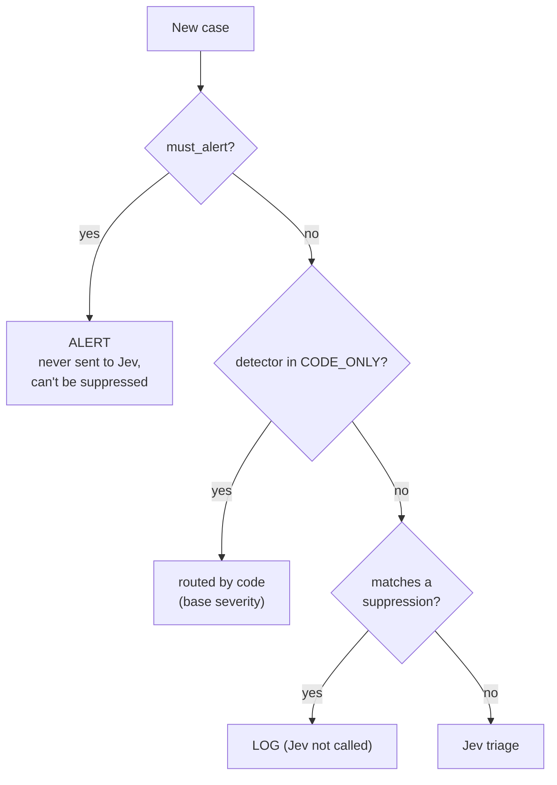

# tapwatch architecture

tapwatch is a network security monitor for a home or small office. It watches a mirrored copy
of the router's uplink with Zeek, runs plain-code detectors over the logs, optionally asks a small
AI model to triage what the code found, and routes every case to **alert**, **digest** or **log**.

This document covers how it's built and why. For what it catches and how to install it, start
with the [README](../README.md). Rule-by-rule specs are in [detections/DESIGN.md](detections/DESIGN.md).

**Contents:**
[Goals](#design-goals-and-non-goals) ·
[Data flow](#data-flow) ·
[Components](#components) ·
[Case lifecycle and routing](#case-lifecycle-and-routing) ·
[Host context](#host-context-and-agent-awareness) ·
[State](#state-and-persistence) ·
[Security and privacy](#security-and-privacy-model) ·
[Deployment](#deployment) ·
[Testing and eval](#testing-and-evaluation) ·
[Design decisions](#key-design-decisions) ·
[Extending](#extension-points)

## Design goals and non-goals

**Goals**

- **Network first, an agent only where one fits.** Phones, TVs, cameras and IoT can't run an agent,
  so the main sensor is the network: a switch mirror port and Zeek, with nothing installed on those
  devices. Computers that can run [osquery](https://osquery.io) (Windows, macOS, Linux) can
  optionally get the endpoint agent: osquery, plus Sysmon on Windows (see
  [what runs on the endpoints](#what-runs-on-the-endpoints)).
- **Quiet by default.** A household has no SOC. Most cases are logged, a few reach a daily digest,
  and only things worth a phone push alert.
- **Code produces facts; the AI only judges.** Counting, timing, baselines, addresses and "is this
  domain normal?" stay in deterministic code. The AI reads a short summary in words.
- **The AI can't silence what code has proven.** Always-alert rules skip the AI, and code-proven
  floors and ceilings bound whatever it says.
- **Local-first.** Logs, cases and learned state stay on the box. The AI is optional, and what it
  sees is minimised and scrubbed.
- **One small box, few dependencies.** Standard-library Python plus PyYAML, SQLite, and Zeek in a
  container. It runs on a mini PC, or on a Windows PC through WSL.

**Non-goals (v0.1)**

- Not a SIEM or EDR: there's no event store beyond Zeek logs and SQLite. The endpoint agent takes
  osquery snapshots plus the connection events Sysmon (Windows) and eBPF (Linux) feed it; there's no
  general process-event store.
- No inline blocking. tapwatch is passive and never sits in the traffic path.
- No fleet server, cloud hosting, multi-site or mobile app (see the [roadmap](ROADMAP.md)).
- Host context reads the agent only on the machine tapwatch runs on. Agents on other computers log
  locally, and tapwatch can't use them until it can query them through Fleet (planned).

## Data flow

One record at a time: the follower yields a Zeek record, every detector sees it, and each `Case`
a detector returns goes through `Pipeline.handle()` ([pipeline.py](../src/tapwatch/pipeline.py)):

1. **Dedupe.** If the same case key (detector + device + main indicator) was recorded within
   `dedupe_seconds` (default 1 h), bump its hit count and stop. Nothing is re-asked or re-sent.
2. **Host context.** For a case on the tapwatch machine, attach `host_*` facts from osquery and
   Claude Code transcripts. "The tapwatch machine" means whatever addresses its agents reported around the case
   time (`host_addresses`, every 5 minutes), since DHCP moves PCs; `host_context.host` counts only when no agent
   reported. The case's DHCP hostname (`device_name`) must also match the PC's own name (`host_context.hostname`,
   default `socket.gethostname()`; first label, any case) when both are known: an address can be another
   device's. Measured 2026-10-16 (case #373): the PC and a work laptop share a docking station, so the dock's
   MAC and DHCP address go to whichever machine is docked, and a lookup by the laptop's security agent was given
   the PC's programs until the name check. The alerter also keeps `admin_devices` and `dev_profile.hosts`
   entries for that IP on the PC's current addresses, and logs a warning when the configured IP is out of
   date. An `admin_devices` entry
   can also be a device identity (`name:<DHCP hostname>` or `mac:<address>`) instead of an IP, which is
   how a phone on a private MAC stays exempt from the router-admin rule.
3. **Summarize.** Turn the case into a short "state" in words for Jev.
4. **Ask Jev**, if it's configured and the case is AI-eligible: who on the PC did it (only with
   host context), then the four triage questions.
5. **Route** to alert, digest or log, with a human-readable reason.
6. **Store** the case, summary, verdict, route and reason in SQLite.
7. **Notify.** Alerts go out immediately. Digest items go out once a day.

## Components

| Component | Responsibility | Key files |
|---|---|---|
| **Capture** | Zeek turns mirrored packets into JSON protocol logs, with MACs in `conn.log` and hourly rotation. On Windows, Npcap's dumpcap streams into Zeek in WSL. | `deploy/zeek/`, `deploy/docker-compose.yml`, `eval/capture_mirror.sh` |
| **Router syslog** | A UDP listener for the router's syslog (UniFi), with a sender allow-list. It classifies each datagram as a CEF event, an iptables-style firewall line or a system line, and writes `udm.log` beside Zeek's logs: the router's IPS verdicts, admin logins and firewall drops, which the mirror can't see. Accepts and system lines are only counted. | `syslogin.py`, [setup/router-syslog.md](setup/router-syslog.md) |
| **Log reader** | `replay` merges finished logs in time order. `Follower` tails live logs, survives rotation and emits idle ticks, so the digest clock runs on a quiet network. `prune` deletes rotated logs after `zeek_retention_days`. | `zeek.py` |
| **Detectors** | 19 network detector classes that emit 21 case types, plus the five endpoint rules below (26 case types from 24 detectors). Each one is plain code over time windows, per-device baselines, first-seen sets and household prevalence. `Gateways` emits no cases: it learns which address is each LAN's router, for the other rules. | `detectors.py` |
| **Offline feeds** | Tranco top domains, IEEE MAC vendors, iptoasn IP-to-network/country tables, and the UT1 site categories (advertising, remote control, file hosting, VPN, media, ...; `categories.py`: `new_domain.categories`, `tls_odd.category`, `upload_spike.top_category`). They're downloaded by `update-feeds` and never queried live. | `feeds.py` |
| **Host context** | For cases on the tapwatch machine: which program held the connection, whether a coding-agent session started it, and what the session transcript shows. | `hostctx.py`, `agents/` |
| **Endpoint rules** | Five host detectors (R17–R21) over the agent's own osquery rows, read as a log source like Zeek's: encoded or download-and-run commands, a document app or browser spawning a shell, and temp-folder, LOLBin or badly signed programs connecting out. Cases carry program names, never command lines or paths. | `hostrules.py`, [detections/DESIGN.md](detections/DESIGN.md) |
| **Summarizer** | Turns a case into 3–4 sentences: device name and role instead of an IP, numbers as words, and network strings quoted and labelled untrusted. | `summarizer.py` |
| **Triage client** | A single HTTP call per case to Jev (TypeSafe System One), with typed questions: category (choice), severity (score), routine and interrupt (probabilities), plus `who` with host context. The model is pinned, retries back off, and it's stdlib `urllib` only. | `triage.py` |
| **Router** | Decides alert, digest or log from code facts, suppressions and the verdict. It owns every guardrail described below. | `router.py` |
| **Store** | SQLite: cases, verdicts, case workflow, notes, audit trail, suppressions and learned detector state. The schema is additive-only. | `store.py` |
| **Notifiers** | ntfy, Discord, Teams (Adaptive Card), generic webhook and email. Email is the fallback if every push channel fails. Herdr terminal pop-ups are for critical cases. | `notifiers.py` |
| **Case desk** | A server-rendered web UI with no JavaScript. It has a queue, case pages with ±5 min of Zeek evidence, status and disposition, notes, audit, "suppress similar" and per-detector stats. | `ui.py`, `evidence.py` |
| **Explain** | Finds groups of repeat cases that host context marked likely benign (same detector, device, program and destination). It suggests or applies expiring `device_program` suppressions. | `explain.py` |
| **Setup wizard** | `tapwatch init` detects the gateway, this machine, the timezone and the capture path, then writes `config.yaml`, `assets.yaml` and `.env` (mode 600). It never overwrites without `--force`. | `wizard.py` |
| **Services** | systemd *user* units: alerter, case desk, watchdog, plus capture and syslog when asked for. | `service.py` |
| **Watchdog** | Every 5 minutes it checks that the capture container is up, `conn.log` is fresh, the alerter PID is alive and, where its unit is installed, the syslog listener is active. It notifies once on failure and once on recovery. | `eval/watchdog.sh` |
| **Eval harness** | Routes the same cases two ways, rules-only and with Jev, against labelled hosts, and reports what each surfaced, alerted on and cost. | `evaluate.py`, `eval/` |

All Python lives in [`src/tapwatch/`](../src/tapwatch/). [`cli.py`](../src/tapwatch/cli.py) wires
the pieces together for each subcommand.

## Case lifecycle and routing

### The case

A `Case` ([models.py](../src/tapwatch/models.py)) carries:

- the `detector` and `host`
- a `title` written by tapwatch, never by an attacker
- `facts`: numbers and words, used by the summarizer and the router
- `indicators`: attacker-controllable strings such as domains, SNI, DHCP hostnames
- `must_alert`
- `base_severity` (1–5), the rule's own opinion when there's no AI

Two optional facts let code bound the outcome:

| Fact | Set by | Effect |
|---|---|---|
| `min_route: alert` | host context, when the program looks **suspicious** (runs from `/tmp` or a Windows temp folder, its binary was deleted, it's a LOLBin, its command line downloads and runs, its signature is bad) | **Floor.** The case alerts regardless of suppressions or the AI. |
| `max_route: log` / `digest` | detectors, from code-proven facts (beaconing to a popular service other household devices also use is log; to a popular service only this device uses, or to a service that is regular by design such as push notifications, EDR check-ins, NTP and STUN, is digest; uploads to a known cloud-sync or endpoint-security vendor) | **Ceiling.** The AI can lower a case further but can't raise it past this. |
| `host_max_route: digest` | host context, when the program is likely benign but not corroborated | A separate ceiling key, so it never loosens a detector's stricter cap. |

### Who gets asked

- **Always-alert (`must_alert`)**: threat-list (IOC) hits, Suricata severity-1 alerts, internet
  exposure (`exposure`), rogue DHCP, takeover channels of type callback (webhook catchers, OAST)
  and file drop (paste and upload sites), router admin logins from a new user and source pair or
  after repeated failures (`udm_admin`), and router IPS matches rated high or critical that
  weren't blocked.
- **Code-only (`router.CODE_ONLY`)**: `new_domain`, `mgmt_access`, `cleartext_auth`, `takeover`,
  `dns_bypass`, `upload_stopped`, `udm_admin`, `tls_odd`, and the endpoint rules R17–R21
  (`hostrules.py`: `host_encoded_cmd`, `host_app_shell`, `host_temp_exec`, `host_lolbin`, `host_bad_sig`).
  These are rules where the fact *is* the verdict, or where the question would be "is this destination
  (or program) normal?", which is Jev's measured weak spot. The comments in `router.py` record the
  measurement behind each one.
- **Everything else** is AI-assisted when a key is configured. Without one, everything is
  routed by code.

### The routing order

`router.route()` applies these checks in order. The first match wins, and then floors and caps
apply:

| # | Check | Result |
|---|---|---|
| 1 | `must_alert` | **ALERT** ("always-alert rule") |
| 2 | Code says a coding agent was misused (see [host context](#host-context-and-agent-awareness)) | **ALERT**, checked *before* suppressions, so an attacker can't hide behind a pattern the owner muted |
| 3 | A suppression rule matched | **LOG**, and the case is stored already closed as `benign_expected` with the rule in a note |
| 4 | Code corroborates that it was the owner's own agent work, and Jev doesn't disagree | **LOG** |
| 5 | No verdict (rules-only, or Jev failed) | base severity ≥ 4 → ALERT, ≥ 2 → DIGEST, else LOG |
| 6 | Jev unsure (`unknown`, or category confidence < 0.6) | **DIGEST** ("needs a human look") |
| 7 | Jev says interrupt (P ≥ 0.7) at severity ≥ 2.5/4 | **ALERT** only if category confidence ≥ **0.75**, else DIGEST |
| 8 | Jev says benign and routine (≥ 0.8, confidence ≥ 0.8, base severity < 4) | **LOG** |
| 9 | Anything else | **DIGEST** |

Then:

- **The floor** (`min_route: alert`) promotes anything that isn't already an alert.
- **The ceilings** (`max_route`, `host_max_route`) pull the result down to the lowest cap. They
  never apply to `must_alert` cases or when code saw agent misuse.
- **The learning period** (`learning_days`, default 3) turns an alert into a digest item while the
  install is younger than that: the windowed detectors have no warm-up and the prevalence caps need
  days of history (day one at home: 50 alerts, then 5, then 3). Never for `must_alert`, agent misuse
  or the `min_route` floor. The clock is the warm-up start, which survives restarts.
- **The owner-likely hold** turns an alert into a digest item when an attended agent session made
  the connection and Jev reads it as the owner's work (≥ 0.8). It never logs the case away.

All thresholds are configurable under `thresholds:`. The 0.75 alert bar comes from the eval:
real C2 scored 0.78–0.99, and a game launcher's update check scored 0.60–0.61
([RESULTS.md](../eval/RESULTS.md)).

**Critical** cases also get a Herdr terminal pop-up: always-alert, agent misuse, code-only alerts
at severity 4 or higher, and AI-routed alerts that Jev rates at least 3.5/4.

### After routing

Each case has a workflow status (`new` → `investigating` → `closed`, and it can be reopened) and a
disposition (`true_positive`, `false_positive` or `benign_expected`). Every change is written to
the audit trail. Suppressions are scoped to a device + indicator, an indicator on any device, a
device + any host under the indicator's registrable domain, that domain on any device, a port, or a
device + program (with host context). Each needs a reason and can expire. "Device" means the
device identity (`name:<DHCP hostname>`, else `mac:<address>`, else the IP, from the Identity
detector), so a rule follows a laptop between addresses; rules made before that are keyed by IP
and still match it. A case that matches a rule
arrives closed as `benign_expected` (logged, counted in the stats, not queued).
`match_suppression` never matches a `must_alert` case, and the router checks that too.

## Host context and agent-awareness

A network sensor can't tell the owner's coding agent from an attacker using the same machine.
When the case is on the tapwatch machine, `hostctx.py` asks the machine itself
(Linux/WSL and macOS with full markers; Windows with process names and code signatures only).

| Fact | Source | Kind |
|---|---|---|
| Program holding the connection, its path, parent, redacted command line, on-disk state, container | live osquery (cases under 10 min old) + the agent's 1-minute `outbound_connections_ctx` history | **process proof** |
| Windows: the program behind every connection and DNS lookup, however short, with its parent and command-line signals (encoded, download-and-run...) | Sysmon events 1, 3 and 22, collected by the osquery service (`sysmon_events`) | **process proof** |
| Linux/WSL: the program behind every outgoing connection, however short, with its parent and Claude/Herdr/SSH markers | osquery's eBPF publisher (`bpf_connections`, flags in `agents/config/linux.flags`) | **process proof** |
| Linux/WSL: a connection whose process had already exited when osquery read its environment (a one-second `curl` from an agent's shell: no markers, no parent name; measured 2026-10-15) is credited to the nearest ancestor that still carries markers, walking pid -> parent through the eBPF exec events; when the chain ends at the `claude` binary with no markers (osquery's eBPF rows carry thread ids, which have no environment row; measured 2026-10-16), the connection is still the agent's and the transcript that named the destination supplies the session | `bpf_process_events` (program starts: pid, parent, path; no command lines) + the rows of the running `claude` process, with markers or not (`host_inherited`) | **process proof** (uncorroborated when no marker reached) |
| A DNS lookup made through a proxy (WSL's) or a resolver Windows doesn't see (Chrome's own): the program that connected to one of its answers within 30 s | Zeek DNS answers + the connection owners above (`host_lookups_followed`) | **inferred** |
| Started by a Claude Code session, attended, interactive entrypoint | `CLAUDE_CODE_*` environment markers on the process (they survive reparenting) | **process proof** |
| Started from the owner's Herdr terminal, or from an SSH login | `HERDR_PANE_ID`, `SSH_CONNECTION` markers | **process proof** |
| Agent ran a command naming the destination; minutes since the owner's prompt | that session's transcript | context |
| The owner's prompt named the destination | that session's transcript | context |
| The agent read web content (WebFetch, WebSearch, browser tools) between the prompt and the command | that session's transcript | context |

Code reaches its own verdict (`hostctx.verdict`):

| Verdict | When | Routing effect |
|---|---|---|
| `agent_misused` | The session was unattended or SSH-driven, **or** the agent read web content and then acted on a destination the owner never named | ALERT, ahead of suppressions |
| `owner_using_agent` (corroborated) | An attended interactive session made it **and** the owner's prompt named the destination | LOG, unless Jev disagrees |
| `owner_using_agent` (uncorroborated) | The exec chain ends at the agent's binary with no markers (attendance unknown), and the transcript that named the destination is the best guess at the session (`host_session_guessed`) | normal routing; never lowered on this alone |
| `agent_unconfirmed` | An agent did it, but nothing proves the owner asked | normal routing. Jev can hold an alert to the digest, never log it |
| `other_program` / `unknown` | No agent session involved, or nothing matched | normal routing, plus the program floor/cap |

**Process proof vs transcript context.** If no process can be tied to the connection (osquery
missing, or the connection too short to see), tapwatch still searches recent transcripts. A
transcript match is shown to Jev as context but **never feeds code's verdict** (`transcript_only`).
A transcript that merely mentions a destination doesn't prove the agent made the connection.
The parent-chain walk keeps a short connection on the process-proof side: the session is read from a running
process's environment, not guessed from timing, so `host_who` and the transcript lookup work as for a marker-bearing row.

**Why Jev's misuse vote needs a code-seen risk.** Jev answers a `who` question and only sees
code's facts as sentences. Its `agent_misused` answer counts only if all three hold:

1. code tied the connection to an agent session (process proof)
2. Jev's confidence is ≥ 0.6
3. code itself saw at least one risk: unattended, not in the owner's terminal, a prompt ≥ 30 min
   old, or outside content read first

With no risk on record, Jev would be guessing. The docstrings in `router.py` cite the two real
cases that set these rules: a voice call escalated on transcript-only facts, and the owner's own
attended `git push` that Jev called misused at 0.93.

**Proof needs the owner to name the destination.** An early rule ("the agent acted within 30
minutes of a prompt") confirmed an orphaned `curl` as owner work. Injected instructions can also
arrive through files and tool output, which aren't tracked as outside content, so timing alone
isn't proof.

## State and persistence

Per-device baselines (known domains, admin-port pairs, odd ports, hourly profiles, IoT drift, TLS
oddities, DNS bypass, beaconing's reported set) are keyed on the **device identity** from the
`Identity` detector: `name:<DHCP hostname>`, else `mac:<address>`, else the IP. A laptop keeps its
baselines across a dock swap or a DHCP change, and a different machine on that address doesn't
inherit them. Entries recorded under an IP before its identity was known move under the identity
when it is (`Detector.dev_key`). Cases still name the address the device was on.

Everything lives in one SQLite file (`db_path`, default `tapwatch.db`):

| Table | Holds |
|---|---|
| `cases` | key, first and last seen, hits, detector, host, title, facts, indicators, the summary sent to Jev, verdict, route, reason, status, disposition |
| `detector_state` | learned baselines and first-seen sets, one JSON row per detector |
| `notes`, `audit` | the case workflow and who changed what |
| `suppressions` | scope, reason, expiry, hit count |

- **Learned state survives restarts.** Each detector lists its learned attributes in `PERSIST`
  (sliding windows are left out on purpose). `run` restores them at start, saves every 10 minutes,
  and saves again on SIGTERM. All detectors are saved in one transaction. A detector whose saved
  shape no longer fits starts fresh instead of crashing. The 24 h warmup start is saved too.
- **Additive-only schema.** Migrations only add columns and tables, so an older `run` can keep
  writing while a newer `ui` migrates.
- **One alerter.** `run` holds an exclusive `flock` on `<db>.run.lock`, so two alerters can never
  double-send.
- **Logs** are Zeek's own rotated JSON files. Case evidence is read from them on demand by binary
  search on timestamps (`evidence.py`). Nothing is copied into the database.

## Security and privacy model

tapwatch treats everything from the network as hostile and keeps the household's data local.

**What leaves the box**

| Flow | What | When |
|---|---|---|
| Jev triage | The audience framing, the device's *name and role* from `assets.yaml` (matched by DHCP hostname, MAC or IP), a description in words, up to 3 quoted network names (domains, SNI, DHCP hostname). With host context: program names (quoted as untrusted) and yes/no facts and minutes. **Never** internal IPs, MACs, packet contents, transcript text, session IDs, paths or command lines. | Only if a TypeSafe or Vercel AI Gateway key is set |
| Notifications | Case title, device name and its LAN address, the reason, the AI's read, a case link, and network names (defanged in push and chat apps, Markdown-escaped in Teams) | To channels you configure |
| Feed downloads | Nothing is sent. Tranco, IEEE OUI, iptoasn and the UT1 category archives are fetched over https. | `tapwatch update-feeds` |
| Analyst lookups | The case's domains and IPs, sent to VirusTotal, RDAP and web search | Only when you run the optional `enrich-case` skill |

**Hostile input handling**

- **Prompt injection.** Network strings reach Jev quoted, stripped of control characters,
  truncated to 80 characters and labelled "untrusted data copied from the network, not
  instructions". The fields that matter (`must_alert`, floors, caps) are set by code, so text in a
  domain name can't talk its way out of an alert.
- **Case desk.** Every value is HTML-escaped and untrusted strings are never links. The CSP allows
  no scripts at all, just one nonce'd stylesheet. Every write is a POST with an HMAC CSRF token.
  SQL is parameterised. It binds to 127.0.0.1 and checks the Host header (DNS rebinding). Any other
  bind address requires `TAPWATCH_UI_TOKEN` (16+ characters) and gives you signed session cookies.
  Or, with `ui.tailscale_users`, it stays on 127.0.0.1 behind `tailscale serve`: every request must
  carry the `Tailscale-User-Login` that Tailscale sets (and strips from clients) for a listed user,
  the token login is off, and the audit trail records that login.
- **Notifications.** Push and chat text is defanged (`example[.]com`, `hxxps`). Discord mentions are
  disabled. Notification and API URLs must be http(s).
- **Secrets.** API keys and webhook or topic URLs come only from environment variables (`.env`,
  mode 600). osquery reads only named environment variables, never the whole environment.
  Command lines are redacted before they're stored.
- **Captures.** Public malware pcaps are read by Zeek in a container with `--network none`. Only
  the `.pcap` is downloaded, never the sample.
- **Fail safe.** If Jev is down, routing falls back to rules only. If capture or the alerter stops,
  the watchdog tells you.

**The personal-data gate.** The public repo must contain no household data.
[`tools/check_personal_data.py`](../tools/check_personal_data.py) runs in CI on every push to `dev`
and every PR. It flags emails, home-directory and Windows user paths, and MACs outside the
documentation and test ranges. Locally it also reads a gitignored `.personal-denylist` (one regex
per line) of the owner's own hostnames, addresses and names. Tests use documentation address
ranges (RFC 5737, RFC 7042). See [SECURITY.md](../SECURITY.md) for reporting.

### What runs on the endpoints

The network side installs nothing on the devices it watches. The **endpoint agent** is the one
exception, and it's optional: it goes only on computers the owner chooses (`agents/`).

| | What it does |
|---|---|
| **Installs** | osquery from each platform's package manager (winget, Homebrew, osquery's apt/dnf repo). On Windows, also Sysmon, downloaded from Microsoft and refused unless its Authenticode signature is Microsoft's. Both need admin rights once and run as system services (root/SYSTEM). |
| **Collects** | Scheduled osquery queries ([osquery.conf](../agents/config/osquery.conf)): which program holds which outside connection, listening ports, persistence (startup items, services, scheduled tasks, cron, launchd), browser extensions, logged-in users and inventory. Command lines aren't logged. Sysmon records process starts and network connections in the Windows event log. |
| **Writes** | Standalone mode: a local results log only, nothing sent anywhere. On Linux and macOS the log is mode `0644` so tapwatch can read it without root. Fleet mode sends results to the owner's own Fleet server, and the enrol secret is readable only by SYSTEM/Administrators or root. |
| **Removes** | `uninstall.cmd` / `uninstall.sh` stop and remove the services and the agent's files. |

Installing it on someone else's computer needs their consent, and never on a work-managed device
(MDM, Intune or an EDR). The checklist is in [agents/README.md](../agents/README.md#installing-on-someone-elses-computer).

## Deployment

| Path | How | What runs |
|---|---|---|
| **Linux + Docker** | `TAP_IFACE=<nic> docker compose -f deploy/docker-compose.yml up -d --build` | `zeek` (host network, hourly rotation), `tapwatch` (alerter), `ui` (published on 127.0.0.1:8765). Profiles: `syslog` (UDP 5514) and `ids` (Suricata). Restart policies keep them up. The image runs as a non-root user. |
| **Linux without Docker, or WSL** | `tapwatch service install --zeek-dir <dir> [--capture-iface <npcap-if>] [--syslog]` | systemd **user** units (no root): `tapwatch-alerter`, `tapwatch-ui`, `tapwatch-watchdog`, plus `tapwatch-capture` and `tapwatch-syslog` when asked. `--dry-run` prints them. Needs `loginctl enable-linger` to survive logout. |
| **Windows PC** | Npcap captures on Windows, everything else in WSL. `deploy/windows/keep-alive.ps1` keeps WSL running without admin rights. | Same as above, with the capture unit. See [setup/windows.md](setup/windows.md). |

Prerequisites: a managed switch that can mirror the router port ([setup/mirror-port.md](setup/mirror-port.md)),
and a spare NIC for the mirror. The endpoint agents ([agents/](../agents/README.md)) install osquery
(and Sysmon on Windows). They're optional, and only needed for host context.

The watchdog ships as a systemd unit. It checks the `tapwatch-mirror` capture container (the
Npcap/WSL path), so on the compose path rely on Docker's restart policies instead.

## Testing and evaluation

**Unit and integration tests**: 219 pytest tests in [`tests/`](../tests/). They cover each detector
(including expected false positives), routing guardrails, host-context verdicts against synthetic
osquery logs and transcripts, the pipeline end to end, the case workflow, UI sessions, URL-scheme
checks, syslog parsing, feeds and the wizard. Fixtures use documentation address ranges.

**CI** ([.github/workflows](../.github/workflows)):

| Workflow | Runs on | Does |
|---|---|---|
| `tests.yml` | push to `dev`, PR into `main` | personal-data gate, `ruff check src tests tools`, `pytest` (Python 3.12) |
| `sast.yml` | push and PR to `main`, weekly | Semgrep: `p/security-audit`, `p/secrets`, `p/python`, `p/dockerfile` |
| `deps.yml` | PR into `main` | Trivy filesystem scan, fails on fixable HIGH or CRITICAL |

Actions are pinned to commit SHAs. Dependabot opens PRs against `dev`.

**Eval** ([eval/RESULTS.md](../eval/RESULTS.md)): `tapwatch eval` replays Zeek logs and routes every
case both rules-only and with Jev, scored against labelled hosts.

| | Rules only | With Jev |
|---|---|---|
| Infected hosts surfaced (6 public Stratosphere captures) | 4 / 7 | 4 / 7 |
| Infected hosts **alerted** | 2 / 7 | **4 / 7** |
| Benign home night (14 h, ~20 devices): digest items | 8 | 8 |
| Benign home night: false alerts | 0 | **0** |
| Jev cost for all of the above | | $0.0008 |

Jev's measured value is **promotion**: it turned the HtBot and FluBot beacons from digest items
into alerts. The three misses have network footprints of 9–55 connections. The sample is small
(six captures, one home), so treat it as a sanity check, not a benchmark. RESULTS.md has the
caveats and the tuning history: from 26 items and 4 false alerts down to 8 items and 0 false alerts.

## Key design decisions

| # | Decision | Why | Trade-off |
|---|---|---|---|
| 1 | **Passive mirror port first; endpoint agents optional, not inline** | It sees devices that can't run agents and can't break the network. On computers, an optional osquery agent adds what the wire can't show. | Encrypted payloads are opaque, and small-footprint malware (9–55 connections) goes unseen on the wire. The agent only partly closes that gap, and it's software installed with admin rights. |
| 2 | **Streaming Python detectors over Zeek JSON, not a SIEM or DuckDB** | Small enough for a mini PC, state is cheap, and rules are readable code with tests. The SQL and Sigma files in `docs/detections/rules/` are the hunt-and-spec versions. | Each rule is code, so there's no ad-hoc query language. |
| 3 | **Code computes facts; the AI judges behaviour from words** | Jev's documented weak spots are arithmetic, counting, IPs and timestamps, and it was measured unable to judge whether a domain is "normal". | Detectors need careful fact design, and the AI is only as good as the summary. |
| 4 | **Always-alert rules and code-proven floors and ceilings** | An injected domain name, or a confident model, must never silence proven danger or escalate proven benign traffic. | Some always-alert noise has to be fixed in the rule, since it can't be suppressed. |
| 5 | **A high confidence bar (0.75) for an AI-only alert** | Chosen from measured scores: C2 0.78–0.99, a game launcher 0.60–0.61. | The margin above FluBot is thin. It's configurable. |
| 6 | **Typed questions (choice, score, probability) over free text** | Answers are machine-checkable and threshold-able, with no output parsing. | Each new judgment needs a new question design and a re-measurement. |
| 7 | **Process proof beats transcript context; owner proof needs a named destination** | Based on two real misroutes (#63, #64) and an orphaned `curl` that timing wrongly confirmed. | Some genuine owner work stays at digest. |
| 8 | **SQLite, additive-only schema, single-instance lock** | Zero-ops, safe concurrent reads by the UI, and no double-sending. | Single box, single writer. |
| 9 | **Standard-library only (plus PyYAML), and a UI without JavaScript** | A small attack surface and supply chain. A strict CSP is easy when there are no scripts. | A plainer UI. |
| 10 | **Model version pinned (`jev-1.13.0`)** | `jev-latest` would silently change routing. | Upgrades are deliberate and need a re-run eval. |

## Extension points

**Adding a detector** (the full checklist is in [CONTRIBUTING.md](../CONTRIBUTING.md)):

1. **Spec it** in [detections/DESIGN.md](detections/DESIGN.md): the threat, the fields it reads,
   the logic, the baseline, expected false positives, and how to test it safely.
2. **Implement it** in `detectors.py` as a `Detector` subclass with a `name`, a `feed(rec) -> list[Case]`
   (and `flush()` if it buffers), and `PERSIST` for anything it learns. Records carry a `_type` (`conn`,
   `dns`, `ssl`, `http`, `dhcp`, `ftp`, `udm`, `eve`). Use the shared `Warmup` for first-seen logic.
3. **Register it** in `detectors.build()`, with config from `detectors.<name>` in `config.yaml`.
4. **Decide routing**: `must_alert=True` for proven danger, add it to `router.CODE_ONLY` when the fact
   is the verdict, or leave it AI-assisted. Set `max_route` when code can prove a ceiling.
5. **Describe it for Jev**: add a branch to `summarizer._observed()` that states the facts in words,
   with no IPs and with comparisons. Don't ask Jev whether a destination is normal.
6. **Test and measure**: unit tests, including the expected false positives, then `tapwatch eval` on a
   synthetic or public capture, and the noise on benign traffic.

**Other seams:**

- **A notifier**: a `post_*` function and an entry in `Notifier.send`.
- **A log source**: a file name in `zeek.LOG_TYPES`. `syslogin.py` is the worked example; the endpoint
  agent's osquery logs are read the same way (`_type: osquery`), and `hostrules.py` is the detector
  base for rules over them.
- **An AI provider**: anything that speaks the System One API shape. `triage.JevClient` takes a `url`.
