# Roadmap

_Where tapwatch is, and where it's going. The [GitHub milestones](https://github.com/barnabys-drew/tapwatch/milestones) are the source
of truth for individual items; this page is the why and the order._

```mermaid
flowchart LR
    A["<b>v0.1</b> · shipped 2026-10-13<br/>network detection, guardrailed AI triage,<br/>case desk, Linux + Windows install"]
    B["<b>v0.2</b> · shipped 2026-10-20<br/>prove it outside one house:<br/>long-running test, clean installs"]
    B2["<b>v0.2.5</b> · done 2026-10-20<br/>easy install: one-step Windows<br/>installer, tapwatch doctor"]
    C["<b>v0.3</b> · built, closing<br/>endpoint rules: living off the land,<br/>per OS, then installed software"]
    D["<b>Later</b><br/>Fleet, richer TLS and domain intel,<br/>packages and images"]
    E["<b>v0.4</b><br/>learning from history: 30-day behavior,<br/>a judge that does tier-1 triage"]
    F["<b>v0.5</b><br/>home XDR: email, DNS, identity<br/>and endpoint signals, one-tap response"]
    A --> B --> B2 --> C --> D --> E --> F
    style A fill:#2e7d32,color:#fff
    style B fill:#2e7d32,color:#fff
    style B2 fill:#2e7d32,color:#fff
    style C fill:#f9a825,color:#000
```

## Where we are

**[v0.2.0](https://github.com/barnabys-drew/tapwatch/releases/tag/v0.2.0)** is the current release (2026-10-20);
tapwatch has been running on a real home network since v0.1.0 shipped. It watches a mirror port with Zeek, runs
22 network and 17 host case types from plain-code detectors, and asks a small AI model (Jev) for triage. Code-proven facts can floor or cap that triage. Alerts go to a phone, a daily digest catches
the rest, and a no-JavaScript case desk handles the workflow. See [ARCHITECTURE.md](ARCHITECTURE.md).

| Area | State |
|---|---|
| Network detection | **Solid.** 22 network case types, baselines that survive restarts, a scripted self-check at 27/27 in CI. [Eval](../eval/RESULTS.md): 4/7 infected hosts alerted vs 2/7 rules-only; a home night gave 8 digest items and 0 false alerts |
| AI triage | **Solid.** Guardrails measured; cost is well under a cent a day at home volumes |
| Linux install | **Solid.** `docker compose up`, verified end to end on a live interface. Zeek runs from a patched 9.0 LTS image as the user, not root ([#252](https://github.com/barnabys-drew/tapwatch/pull/252)). A native host install for Arch-based desktops (Omarchy) is in progress |
| Windows install | **Passed on a clean machine.** The one-step installer went from the ZIP to a test alert on a fresh Windows 11 VM (v0.2.5, [#175](https://github.com/barnabys-drew/tapwatch/issues/175)), and `tapwatch doctor` names what's wrong. The first outside install is next |
| Host context (who on the PC made this traffic) | **A week of real data reviewed** (v0.2, [#4](https://github.com/barnabys-drew/tapwatch/issues/4)): a program named for 106 of 136 PC cases, consistent with the owner's review. The intent verdicts never fired on real traffic and stay unmeasured, so host context still does not lower alerts on its own |
| Endpoint rules | **Built** on Windows (osquery + Sysmon) and Linux (osquery eBPF): R17–R29 and R36–R39, plus R48 known-exploited software. A host case and a network case on the same PC pair only when the host rule names that network rule (`hostrules.PAIRS`). v0.3 closes after R39's first week |
| Router syslog | **Verified on a live gateway** (2026-10-16). CEF events and firewall lines parsed as sent; admin logins checked against a real line. IPS verdicts still await a real detection |
| macOS | **Later.** Waiting on a tester with a Mac; it won't ship untested |

### 2026-10-20 to 10-21: v0.3 built, vulnerable software, less noise

- **v0.3's last rules**: R36 remote-access tools, R37 tunnels, R38 staging, R39 persistence and credential files
  ([#235](https://github.com/barnabys-drew/tapwatch/pull/235), [#236](https://github.com/barnabys-drew/tapwatch/pull/236),
  [#238](https://github.com/barnabys-drew/tapwatch/pull/238)). Each one's safe test raised its case on the live PC.
  Those runs also showed every test case lifted to an alert by an unrelated digest item, so a host rule now names
  the network rules that tell its story, and only those pair with it (`hostrules.PAIRS`,
  [#240](https://github.com/barnabys-drew/tapwatch/pull/240), [#242](https://github.com/barnabys-drew/tapwatch/pull/242))
- **Vulnerable software** (v0.5's first piece): a software inventory from the agents, CISA KEV, OSV and NVD data
  through `update-feeds` (downloads only), and R48 `vuln_kev`, which also raises the device's other cases while
  it's open ([#253](https://github.com/barnabys-drew/tapwatch/pull/253), [#257](https://github.com/barnabys-drew/tapwatch/pull/257))
- **Zeek 9.0 LTS** with Debian's fixes: 30 critical and 312 high findings down to 0 fixable, and capture runs as
  the user ([#252](https://github.com/barnabys-drew/tapwatch/pull/252))
- **The Linux eBPF connection feed** went silent for a day: osquery was restarted mid-query and denylisted it. Its
  lookups now read one process instead of all of /proc (5.2 s to 0.5 s on 300 rows), and both eBPF feeds are never
  denylisted ([#244](https://github.com/barnabys-drew/tapwatch/pull/244))
- **Noise cut from live cases**: `upload_spike` spreads a long connection's bytes over its life, so a 25-hour
  session no longer reads as a one-hour burst ([#259](https://github.com/barnabys-drew/tapwatch/pull/259)); Windows'
  own scheduled rundll32, a two-adapter PC and read-only tunnel commands stop raising cases
  ([#250](https://github.com/barnabys-drew/tapwatch/pull/250)); R22 counts silence across restarts
  ([#246](https://github.com/barnabys-drew/tapwatch/pull/246))
- **R16** says whether a remote-control session's other end is another device in the house, and sends it to the
  digest when both ends are labelled ([#261](https://github.com/barnabys-drew/tapwatch/pull/261)); `ioc_match`
  gained the AdFection / Candiru spyware indicators, tiered ([#248](https://github.com/barnabys-drew/tapwatch/pull/248))

### 2026-10-17: the monitor watches itself

Twelve reviewed PRs in one day, each with a measured basis:

- Host context corroborates the chain-only owner verdict when the owner's prompt named the destination,
  matches transcripts by name before address, recognises the agent by its exec row, scopes its window to
  the case's own destination and carries that address as a fact ([#112](https://github.com/barnabys-drew/tapwatch/pull/112),
  [#114](https://github.com/barnabys-drew/tapwatch/pull/114), [#117](https://github.com/barnabys-drew/tapwatch/pull/117),
  [#125](https://github.com/barnabys-drew/tapwatch/pull/125))
- Beaconing's beat window survives a restart, so a slow heartbeat is not lost to a deploy
  ([#116](https://github.com/barnabys-drew/tapwatch/pull/116)); tls_odd stops scoring WebRTC media's by-design signs
  ([#119](https://github.com/barnabys-drew/tapwatch/pull/119)); every stats tile opens the cases it counts
  ([#121](https://github.com/barnabys-drew/tapwatch/pull/121))
- The Windows agent checks code signatures once per program instead of per socket: the per-socket query took
  15 s and osquery's watchdog had denylisted it for 24 h twice, leaving R21 blind for a day each time
  ([#123](https://github.com/barnabys-drew/tapwatch/pull/123)); the R21 retest then passed live (DESIGN.md R21)
- **R22 `feed_silence`**: every feed has a measured longest-allowed silence; a stopped feed is a case within
  minutes. It caught the denylisted socket query ten minutes after deploy
  ([#127](https://github.com/barnabys-drew/tapwatch/pull/127), [#132](https://github.com/barnabys-drew/tapwatch/pull/132))
- `tapwatch selfcheck`: 18 scripted attack and false-positive shapes through the detectors as configured, a
  detection rate, exit 1 on a regression, in CI ([#128](https://github.com/barnabys-drew/tapwatch/pull/128))
- `tapwatch benchmark` and two stats-page sections: week-by-week noise rate, Jev agreement with dispositions,
  host-context accuracy ([#130](https://github.com/barnabys-drew/tapwatch/pull/130))

### v0.1.1 (2026-10-14): host context grows up

Host context grew from "which program" to "is that program OK", and the Windows endpoint agent works:

- An assessment per case (suspicious, likely benign or unclear) from what ran on the PC, and
  `tapwatch explain`, which suggests program-scoped suppressions for repeat cases host context
  explains ([#2](https://github.com/barnabys-drew/tapwatch/pull/2))
- Container processes are no longer mistaken for deleted binaries
  ([#3](https://github.com/barnabys-drew/tapwatch/pull/3))
- Windows awareness: Authenticode signatures, Windows paths, living-off-the-land binaries, and a
  one-click osquery + Sysmon installer ([#31](https://github.com/barnabys-drew/tapwatch/pull/31),
  [#32](https://github.com/barnabys-drew/tapwatch/pull/32))
- The AI can't call the owner's own agent work "misused" unless code saw a risk
  ([#33](https://github.com/barnabys-drew/tapwatch/pull/33)), and Windows signatures osquery can't read
  are checked by Windows itself ([#34](https://github.com/barnabys-drew/tapwatch/pull/34))

## v0.2: prove it outside one house ([milestone](https://github.com/barnabys-drew/tapwatch/milestone/1))

v0.1 is tuned on one network. v0.2 is about evidence that it holds up elsewhere and over time, and that
someone else can install it without help.

**Done 2026-10-20**, released as [v0.2.0](https://github.com/barnabys-drew/tapwatch/releases/tag/v0.2.0). Everything in it closed: Sysmon command lines, connections and DNS lookups for Windows
cases (#15), a clean-machine Windows install (#6), the router's own events (#7, #8), and a week of real host-context
data reviewed (#4, [results](../eval/RESULTS.md#first-week-on-a-live-network-and-host-context-4-2026-10-13-to-2026-10-20)):
attribution named the program for 106 of 136 PC cases, consistent with the owner's review; the intent verdicts
never fired on real traffic and stay unmeasured.

**Done when:** host context has a week of real data reviewed, Windows cases carry the command line behind them,
the Windows path installs on a clean machine from the docs alone, and the README shows the case desk.

| Issue | What | Status |
|---|---|---|
| [#15](https://github.com/barnabys-drew/tapwatch/issues/15) | Windows endpoints: command lines, connections and DNS lookups from Sysmon | **done** 2026-10-15 |
| [#4](https://github.com/barnabys-drew/tapwatch/issues/4) | Long-running test of host context on an installed osquery agent | **done** 2026-10-20: 136 PC cases, a program named for 106, all noise; intent verdicts never fired ([results](../eval/RESULTS.md)) |
| [#6](https://github.com/barnabys-drew/tapwatch/issues/6) | Clean-machine test of the Windows (WSL + Npcap) path | **done** 2026-10-18 on a fresh Windows 11 VM: install, Npcap capture into Zeek, and a test alert to Discord. It found the Discord 403 (urllib's default user agent, fixed in #171) and setup gaps now in the doc: WSL features (0x80370114), `docker.io` and `wsl --shutdown` for the docker group, Npcap from npcap.com with a signature check, NAT inside a VM |
| [#7](https://github.com/barnabys-drew/tapwatch/issues/7) | Check the UniFi admin-login mapping against real events | **built** 2026-10-16 ([#88](https://github.com/barnabys-drew/tapwatch/pull/88)): verified against a real admin-access line |
| [#8](https://github.com/barnabys-drew/tapwatch/issues/8) | Router port-forward and UPnP events enrich internet-exposure cases | **built** 2026-10-18 from real UDM Pro audit events (port forward created, changed, removed; UPnP on and off): an exposure case says whether the router has a forward for that port, changed how long before, through which interface and from where, or that UPnP is on |
| [#10](https://github.com/barnabys-drew/tapwatch/issues/10) | Measure Jev with `audience: home` wording vs `office` | **done** |
| [#12](https://github.com/barnabys-drew/tapwatch/issues/12) | Apply `tapwatch explain` suggestions from the case desk | **done** 2026-10-18: an "Explained by host context" section on the suppressions page with one Apply per group (same rule and closing as `explain --apply`, audited under the user), and a digest line while suggestions wait |
| [#9](https://github.com/barnabys-drew/tapwatch/issues/9) | Screenshots of the case desk on synthetic data | **done** |
| [#11](https://github.com/barnabys-drew/tapwatch/issues/11) | Stats page refreshes itself | **done** |
| [#13](https://github.com/barnabys-drew/tapwatch/issues/13) | Test matrix: Python 3.10–3.13 in CI | **done** |

## v0.2.5: easy install ([milestone](https://github.com/barnabys-drew/tapwatch/milestone/6))

The clean-machine test (#6) worked, but took an expert most of an afternoon. The first outside user is new to
all of this: a Windows PC in a UniFi office, installing alone from the docs. So: one installer that does every
step a script can, one command that says what's wrong, and one guide in plain words.

**Done 2026-10-20**, shipped in v0.2.0. The first outside install is ready to send.

**Done when** a fresh Windows 11 machine goes from the downloaded ZIP to a test alert with nothing typed but the
installer's questions, and `tapwatch doctor` reports every problem the #6 run hit by name.

| Issue | What | Status |
|---|---|---|
| [#175](https://github.com/barnabys-drew/tapwatch/issues/175) | Windows one-step installer (`install-windows.cmd`) | **passed** 2026-10-19 on a fresh Windows 11 VM: ZIP to "0 problems" and a test alert via ntfy, all 5 services up, no Ubuntu first-run prompt, no secret in the log. The runs found four bugs, fixed in [#184](https://github.com/barnabys-drew/tapwatch/pull/184), [#185](https://github.com/barnabys-drew/tapwatch/pull/185) and the polish after |
| [#176](https://github.com/barnabys-drew/tapwatch/issues/176) | `tapwatch doctor`: every part of the install, with fixes | **done** 2026-10-18 ([#181](https://github.com/barnabys-drew/tapwatch/pull/181)); all 13 checks ok on the live box |
| [#177](https://github.com/barnabys-drew/tapwatch/issues/177) | `init`: answers from the installer, the optional AI keys | **done** 2026-10-18 ([#180](https://github.com/barnabys-drew/tapwatch/pull/180)) |
| [#178](https://github.com/barnabys-drew/tapwatch/issues/178) | Plain-English guide for a UniFi office | **written** 2026-10-18 (docs/setup/office-unifi.md), to follow step by step |
| [#179](https://github.com/barnabys-drew/tapwatch/issues/179) | README: a "start here", and Status brought up to date | **done** 2026-10-18 |

## v0.3: endpoint rules ([milestone](https://github.com/barnabys-drew/tapwatch/milestone/3))

Some attacks never look odd on the wire: a script that lives off built-in tools, a new scheduled task,
a credential file read. With osquery on the PCs, tapwatch can raise its own **host** cases and tie them
to network cases on the same device ("`certutil` downloaded something, then a new domain started
beaconing").

The rules come in two passes. First **per OS**, for the tools each operating system ships with (Windows
LOLBins, Linux shells and GTFOBins; macOS waits for a Mac tester). Then **installed software**, the less
common but harder case: signed, trusted third-party programs such as remote-management tools, tunnels, sync
and cloud CLIs, vulnerable drivers and DLL hijacks. Most of those work on every OS, so they're written once.

**Done when:** one rule each on Windows and Linux runs end to end, from an installed agent to a routed case, with the
agent's log locked down.

**Built 2026-10-20.** Every rule is on `main`, and each safe test raised its case on the live PC. The milestone stays
open for R39: it ships at digest until a week of file-event volume is measured (from 2026-10-20, so around
2026-10-27), and then its severity-4 cases alert.

| Issue | What | Status |
|---|---|---|
| [#26](https://github.com/barnabys-drew/tapwatch/issues/26) | Framework: osquery process events, host detectors, network correlation | **built** 2026-10-16 ([#87](https://github.com/barnabys-drew/tapwatch/pull/87)): the agent's osquery logs are a log source and `hostrules.py` raises host cases. Host ↔ network correlation built 2026-10-17 (five-minute window, measured on the live history); persistence snapshots are R23. **Done** 2026-10-18: the results log is readable only by its owner ([#166](https://github.com/barnabys-drew/tapwatch/pull/166)). Since 2026-10-20 a host case pairs only with the network rules it names (`hostrules.PAIRS`, [#240](https://github.com/barnabys-drew/tapwatch/pull/240)) |
| [#27](https://github.com/barnabys-drew/tapwatch/issues/27) | Windows living-off-the-land rules (osquery + Sysmon) | **built** 2026-10-16 ([#87](https://github.com/barnabys-drew/tapwatch/pull/87)): R17–R21, 0 cases on 34.5 h of the main PC's agent log. Pass 2 started 2026-10-17 with R23, new persistence entries (tasks, services, startup items, cron, launchd), measured on 40 h: 6 digest items, 0 alerts. R24 the same day: backups, logs, Defender or accounts changed, 0 such starts in 40 h. 2026-10-18: R25 discovery bursts, R26 browser extensions, WMI subscriptions in R23. **Done** 2026-10-18 with R29, lsass memory reads ([#166](https://github.com/barnabys-drew/tapwatch/pull/166)), baseline measured |
| [#28](https://github.com/barnabys-drew/tapwatch/issues/28) | Linux living-off-the-land rules (osquery) | **done** 2026-10-18 ([#148](https://github.com/barnabys-drew/tapwatch/pull/148), [#155](https://github.com/barnabys-drew/tapwatch/pull/155), [#169](https://github.com/barnabys-drew/tapwatch/pull/169)): R27, R28, and R23 on Linux (SSH keys, systemd units, SUID programs, kernel modules, ld.so.preload, privileged containers, bind shells); baselines measured 2026-10-19 |
| [#39](https://github.com/barnabys-drew/tapwatch/issues/39) | Then: living off the land through installed software (RMM, tunnels, sync tools) | **built** 2026-10-20: R36 remote-access tools (#230, [#235](https://github.com/barnabys-drew/tapwatch/pull/235)), R37 tunnels (#231) and R38 staging (#232, [#236](https://github.com/barnabys-drew/tapwatch/pull/236)); safe tests passed live ([#240](https://github.com/barnabys-drew/tapwatch/pull/240)). Drivers, DLL hijacks and the rest moved to #233 under Later |
| [#167](https://github.com/barnabys-drew/tapwatch/issues/167) | R39: file-change monitoring for persistence and credential paths (osquery file_events, Sysmon event 11) | **built** 2026-10-20 ([#238](https://github.com/barnabys-drew/tapwatch/pull/238)), safe test passed live; digest-only until a week's file-event volume is measured |

## Later ([milestone](https://github.com/barnabys-drew/tapwatch/milestone/2))

Ordered by theme, not date.

- **macOS**, once there's a Mac to test on: basic support for the tapwatch box ([#5](https://github.com/barnabys-drew/tapwatch/issues/5)) and
  macOS living-off-the-land rules ([#29](https://github.com/barnabys-drew/tapwatch/issues/29))
- **More endpoints:** host context for other computers through a Fleet server ([#14](https://github.com/barnabys-drew/tapwatch/issues/14))
- **Living off the land, part 2:** vulnerable drivers, DLL hijacks, browsers, Office add-ins and trusted sites
  ([#233](https://github.com/barnabys-drew/tapwatch/issues/233))
- **Sharper detection:** JA4 TLS fingerprints ([#16](https://github.com/barnabys-drew/tapwatch/issues/16)) and a
  newly-registered-domains feed ([#18](https://github.com/barnabys-drew/tapwatch/issues/18)). Done: the Public Suffix List
  ([#17](https://github.com/barnabys-drew/tapwatch/issues/17)), IPv6 exposure ([#19](https://github.com/barnabys-drew/tapwatch/issues/19)) and
  jitter-tolerant beacons ([#24](https://github.com/barnabys-drew/tapwatch/issues/24))
- **AI triage:** majority vote for borderline calls ([#21](https://github.com/barnabys-drew/tapwatch/issues/21)); a triage
  agent built with LangGraph on the owner's own GKE cluster that investigates before it decides: the device's
  other cases, how similar cases were closed, and host context, all through read-only tools that return
  Jev-style summaries and disposition labels, never notes, IPs or MACs. It is opt-in. The router's guardrails
  still apply to its verdict, and it runs in shadow mode against Jev first ([#263](https://github.com/barnabys-drew/tapwatch/issues/263))
- **Packaging and ops:** a container image and PyPI package ([#22](https://github.com/barnabys-drew/tapwatch/issues/22)), TCP/TLS syslog
  ([#25](https://github.com/barnabys-drew/tapwatch/issues/25)), a same-switch VLAN guide ([#23](https://github.com/barnabys-drew/tapwatch/issues/23)).
  Done: a watchdog for every capture path ([#20](https://github.com/barnabys-drew/tapwatch/issues/20)). In progress: a native host
  install for Arch-based Linux desktops (Omarchy)
- [x] Benchmark the progress: a running report from the case history of noise rate, Jev agreement
  with the triage disposition and host-context accuracy, week by week, on the stats page and as
  `tapwatch benchmark` Markdown (asked 2026-10-16, built 2026-10-17, [#130](https://github.com/barnabys-drew/tapwatch/pull/130));
  `tapwatch selfcheck` gives the detection-rate half ([#128](https://github.com/barnabys-drew/tapwatch/pull/128))

## v0.4: learning from history ([milestone](https://github.com/barnabys-drew/tapwatch/milestone/4))

**Long-horizon behavior.** Today's rules decide within minutes to an hour, with short learned baselines (hourly
profiles keep 14 days). Some attacker behavior only shows over weeks: a beacon that checks in once a day,
exfiltration a little at a time, a device quiet for a month that wakes up talking somewhere new. Nightly
per-device summaries of the last 30 days let code flag what's unusual *for that device* and its peers.
These cases default to the digest unless another signal on the same device backs them up.

**Learned triage.** In a SOC, tier 1 reads every alert and closes the routine ones, and tier 2 handles what's left.
In tapwatch the owner is still tier 1: every case waits for a human disposition. Every closed case is also a
labelled example, though: a disposition, notes, suppressions and their reasons, next to the code facts and
Jev's verdict at the time.

A **learned judge** trained on those cases takes over tier 1. It closes the routine cases the owner has already
taught it, says *why* ("closed like 14 earlier cases: same device, same program, all benign"), and leaves the
human as tier 2 for the new, the rare and the risky. The router's rule still holds: it never auto-closes
always-alert rules or code-floored cases, and it never suppresses. It runs in shadow mode for weeks before it
closes anything, and the number that must stay at zero is true positives it would have closed.

**Done when:** in a long-running test, the judge closes a measured share of routine cases on its own, with zero
true positives auto-closed.

| Issue | What | Status |
|---|---|---|
| [#52](https://github.com/barnabys-drew/tapwatch/issues/52) | Long-horizon behavioral detections: 30 days of per-device history | designed 2026-10-20: daily summaries (#193), then R30–R35 (#194–#199) |
| [#37](https://github.com/barnabys-drew/tapwatch/issues/37) | Learned judge: automate tier-1 triage from the owner's closed cases | designed 2026-10-20: training set, guardrails, shadow judge, scorecard, auto-close, drift back-off (#200–#205) |

Each design issue is a sub-issue of its parent, with what it reads, the logic, expected false positives, a safe
test and what it depends on. Open question on #204: the default keeps alert-routed cases out of auto-close.

## v0.5: home XDR ([milestone](https://github.com/barnabys-drew/tapwatch/milestone/5))

The end goal: one story per device from every signal a home has, not just the wire. Each source is something a
household already uses, and each mainly adds *correlation*: a phishing link in the mailbox and the laptop
resolving it three minutes later is a far stronger case than either alone. Response stays owner-approved: one tap,
shown before it runs, recorded, and undoable.

| Issue | What | Status |
|---|---|---|
| [#53](https://github.com/barnabys-drew/tapwatch/issues/53) | Email: correlate phishing in the mailbox with clicks on the network (read-only, no mail gateway) | designed 2026-10-20 (#206–#208) |
| [#54](https://github.com/barnabys-drew/tapwatch/issues/54) | DNS resolver logs and blocking (AdGuard Home or Pi-hole), for devices that can't run agents | designed 2026-10-20 (#209–#213) |
| [#55](https://github.com/barnabys-drew/tapwatch/issues/55) | Response actions: one-tap quarantine and block, always owner-approved | designed 2026-10-20 (#214–#217) |
| [#56](https://github.com/barnabys-drew/tapwatch/issues/56) | Canary tokens: fake credentials and files that alert when touched | designed 2026-10-20 (#218–#220) |
| [#57](https://github.com/barnabys-drew/tapwatch/issues/57) | Identity signals: account sign-ins from new devices or places | designed 2026-10-20 (#221–#223) |
| [#58](https://github.com/barnabys-drew/tapwatch/issues/58) | Vulnerable software: installed programs checked against known vulnerabilities | **built** 2026-10-20 (#224–#227, [#253](https://github.com/barnabys-drew/tapwatch/pull/253), [#257](https://github.com/barnabys-drew/tapwatch/pull/257)): inventory, KEV/OSV/NVD feeds, R48 `vuln_kev`, other cases raised on the device. Open until the agents' software queries run live and a real snapshot goes through R48 |

The v0.5 designs are sub-issues of each row above. Rule numbers: R30–R35 are v0.4, R40–R48 v0.5 (R48 built), and
R36–R39 are v0.3's last rules (#39, #167), now built.

## Not planned

A hosted service, multi-site management, a mobile app, or a SIEM. tapwatch stays one small box that keeps
data at home and stays quiet unless something matters. The triage agent (#263) would be the only piece running
on cloud infrastructure the owner operates. Like Jev and the AI categorizer, it is opt-in, and it sees only redacted
summaries.

## How work lands

Every item is a GitHub issue in a milestone, labelled with its phase (`v0.2` … `v0.5`, `later`) and the goal it
serves (`goal: endpoint attribution`, `goal: correlation`...), so the backlog can be filtered either way. Work
goes `dev` → PR → `main`, and lands only when tests,
Semgrep, Trivy and the personal-data gate pass. A milestone ships as a tagged release with notes.

## History: the road to v0.1

The v0.1 plan, milestone by milestone (all shipped except the items carried into v0.2)

### M1 Foundation: trustworthy main

- [x] Fix the UI login crash. Two UI changes collided when merged: one checked `app.sessions`, the other had removed it.
- [x] CI runs `ruff` and `pytest` on every push to `dev` and every PR into `main` (`.github/workflows/tests.yml`)
- [x] The daily digest goes out on a quiet network: idle ticks from the follower, plus a once-a-day clock that still fires after a late start
- [x] Zeek log rotation on both capture paths (`deploy/zeek/tapwatch-live.zeek`, hourly), the follower survives it, evidence and replay read rotated files, and `zeek_retention_days` prunes old ones
- [x] "Small business, one IT person" wording becomes a config `audience: office | home`. Summaries and Jev's questions follow it; the default stays `office` (the measured wording) until M5

### M2 Detections: the rules people will judge it by

Specs are in `detections/DESIGN.md` and `detections/rules/`. Built: R01–R07, R09, R10, R12–R16, plus host context. R08 is `new_domain` (code-routed); R11 (`udm_admin`) landed with the syslog input in M3.

- [x] Detector state survives restarts: learned baselines are saved to SQLite every 10 min and on shutdown
- [x] R05 new device keyed on MAC (Zeek `mac-logging`), with vendor (OUI table) and randomized-MAC handling
- [x] R06 odd-port and long-lived outbound
- [x] R07 DNS bypass (plain/DoT/DoH/DoQ)
- [x] R09 upload drift against the same hour on earlier days, plus steady-upload-stopped (camera offline)
- [x] R12 off-hours activity (needs 7 nights of history per device)
- [x] R15 DNS tunnelling clause on `dns_anomaly`, plus a retry-loop guard (one dead name isn't DGA)
- [x] R02 IoT egress drift, using an offline ASN/country table (`tapwatch update-feeds`, download only)
- [x] R10 TLS weak-signal stack (JA4 left for later: needs a Zeek package)

### M3 Inputs beyond the mirror

- [x] Syslog listener (UDP) with a CEF parser, sender allow-list and hourly rotation (`tapwatch syslog`)
- [x] UniFi parser: IPS alerts (`udm_ips`) and admin logins (**R11** `udm_admin`). Admin mapping still to check against real events
- [ ] Port-forward and UPnP change events enrich R01 (needs real UDM samples)
- [x] Suricata stays optional: `docs/setup/router-syslog.md` says when it adds anything

### M4 Install and notify: someone else can set it up in an evening

- [x] `tapwatch init`: detects gateway, this machine, timezone and capture path; asks a few questions; writes `config.yaml`, `assets.yaml` and `.env` (600), never overwriting without `--force`
- [x] Notifiers: **ntfy**, **Discord**, generic webhook, alongside Teams, email and Herdr. Network strings are defanged; Discord mentions are off
- [x] **Linux path:** `docker compose up` runs Zeek, the alerter, the case desk and (profile) the syslog listener. Verified end to end on a live interface: logs flow, a CEF line becomes a case, the UI asks for its token, and stopping saves state. Mirror-port guide: `docs/setup/mirror-port.md`
- [x] **Windows path:** `docs/setup/windows.md`, WSL systemd services via `tapwatch service install --capture-iface`, `deploy/windows/keep-alive.ps1` (no admin). Not yet run on a clean machine
- [ ] Clean-machine test of the Windows path (a friend's PC, or a fresh Windows VM)
- [x] Services on both paths: compose restart policies (Linux + Docker); systemd user units for alerter, case desk, watchdog, capture, syslog (Linux without Docker, and WSL), checked with `systemd-analyze verify`

### M5 Proof: numbers for the README

- [x] Jev go/no-go on 6 public Stratosphere captures (`eval/public_captures.sh`), replayed in the network-less container: GO on promotion, 4/7 infected hosts alerted vs 2/7 rules-only
- [x] Benign noise from a home network, aggregates only: 14 h → 8 digest items, 0 alerts (was 26 and 4 before tuning)
- [x] `eval/RESULTS.md`: alerts and noise in rules-only vs Jev mode, cost, and caveats
- [ ] Jev with `audience: home` vs `office` wording on the same cases. Switch the default to `home` if it's no worse

### M6 Release

- [x] Personal-data gate: `tools/check_personal_data.py` (generic patterns in CI, plus a gitignored local denylist of household specifics). It caught a real household MAC in the tests
- [x] Public repo from a clean snapshot (the development history held household specifics, so it stays private)
- [x] README rewrite: what it is, what it catches, setup for each path, the case desk, AI triage and its guardrails, what leaves the network
- [x] Screenshots of the case desk on synthetic data (v0.2, `tools/demo_desk.py`)
- [x] LICENSE (MIT), CONTRIBUTING, SECURITY (private reporting), CODE_OF_CONDUCT, issue templates, package metadata
- [x] SAST, Trivy, tests and the personal-data gate on every PR; Dependabot to `dev`; private vulnerability reporting
- [x] Tagged `v0.1.0` with release notes

